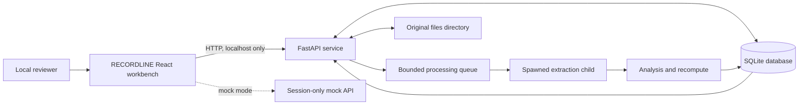
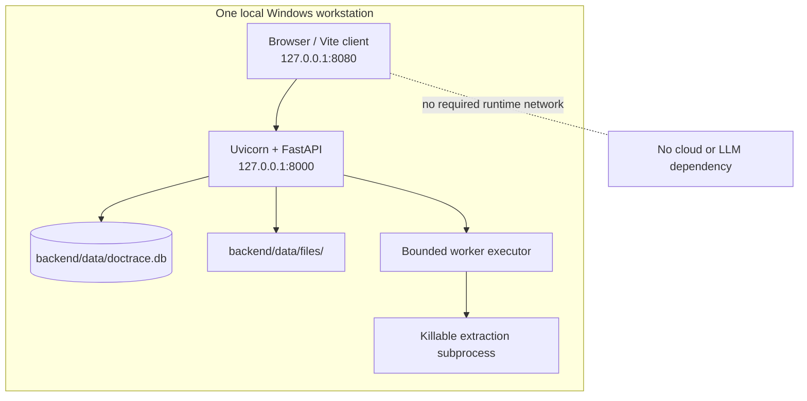
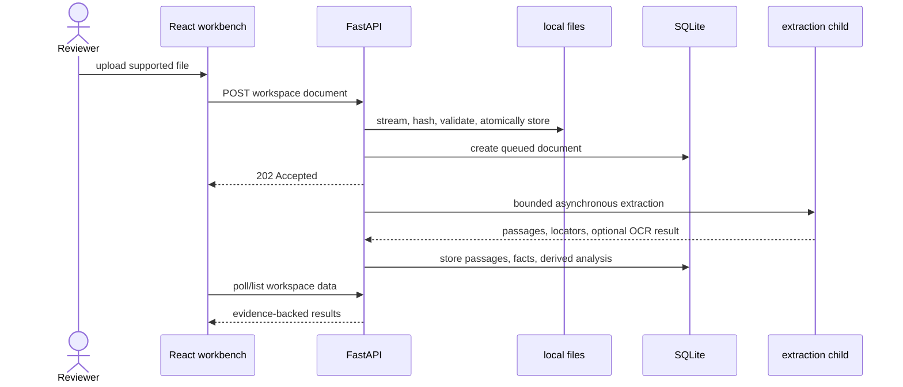
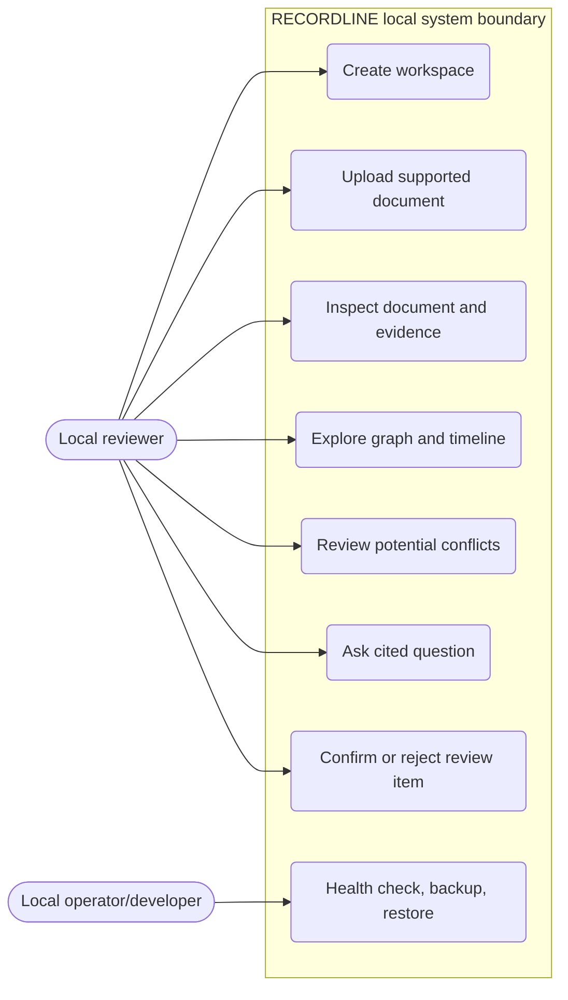
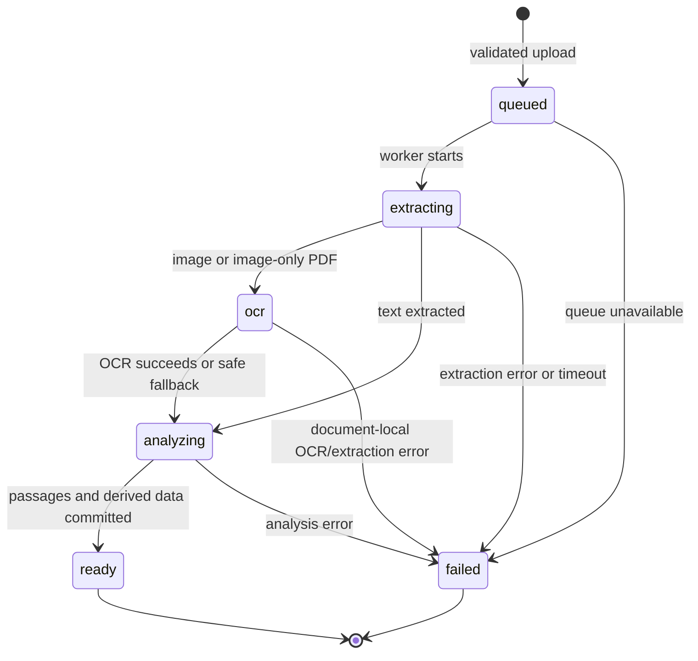
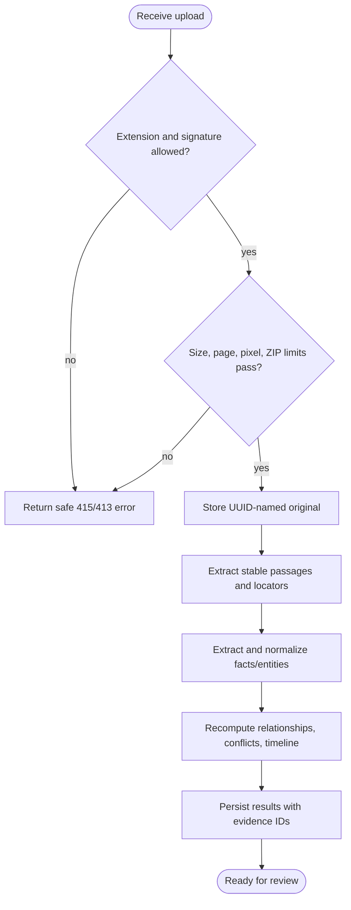
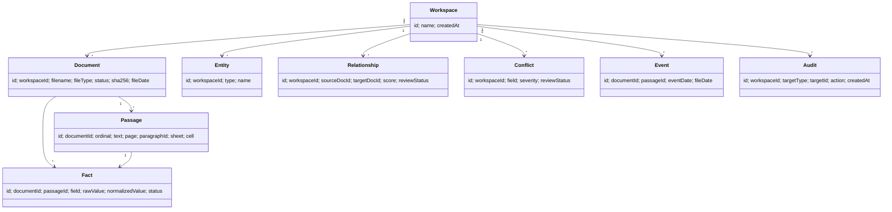
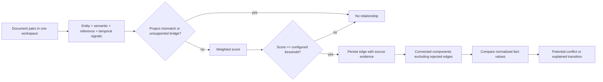

# RECORDLINE Technical Documentation

> **Product name:** RECORDLINE. The source tree retains several `DOCTRACE_*`, `doctrace`, and `doctrace.db` identifiers for compatibility with the current implementation; they are not separate products.

## Contents

1. [Abstract and objectives](#abstract-and-objectives)
2. [Scope, audience, and glossary](#scope-audience-and-glossary)
3. [Technology stack](#technology-stack)
4. [Architecture](#architecture)
5. [UML and other diagrams](#uml-and-other-diagrams)
6. [Core workflow and methodology](#core-workflow-and-methodology)
7. [Algorithms](#algorithms)
8. [Data model and API](#data-model-and-api)
9. [Security, privacy, and operations](#security-privacy-and-operations)
10. [Installation, verification, and troubleshooting](#installation-verification-and-troubleshooting)
11. [Limits and roadmap](#limits-and-roadmap)
12. [Traceability](#traceability)

## Abstract and objectives

RECORDLINE is a local, evidence-first document-intelligence workbench. A single local user creates a workspace, uploads PDF, DOCX, XLSX, PNG, or JPEG files, and follows extracted source passages through document relationships, potential inconsistencies, timeline events, and cited answers.

The central design objective is *inspectable assistance*: every stored conclusion is tied to persisted source passages. RECORDLINE does not use a runtime LLM, does not make runtime network calls, and does not decide which side of a disagreement is true. It flags evidence for human review.

| Objective | Implemented approach | Success boundary |
| --- | --- | --- |
| Preserve evidence | Every fact, edge, event, conflict, and answer citation stores passage/document identifiers. | A user can open the underlying source passage. |
| Process common office evidence locally | Format-specific PDF, DOCX, XLSX, image, and image-only-PDF extraction. | Only supported formats and bounded files are accepted. |
| Surface related records | A guarded hybrid relationship score combines four local signals. | A link is a reviewable hypothesis, not proof. |
| Surface differing values safely | Compare normalized facts only inside relationship components. | A potential conflict never establishes truth. |
| Make questions auditable | Deterministic retrieval and extractive answer rendering cite passages. | Ambiguity is disclosed rather than resolved by the system. |

### Non-goals

- Cloud, public, or multi-user document service.
- Authentication, tenant authorization, remote TLS, or account management.
- General-purpose generative question answering or automatic truth adjudication.
- Support for `.txt`, `.eml`, encrypted Office/PDF files, macro-enabled Office files, or files with external Office relationships.
- A claim of real-world model accuracy from the bundled synthetic evaluation corpus.

## Scope, audience, and glossary

**Audience:** local reviewers who need traceable document analysis, developers maintaining the React/Python application, and operators running it on a Windows workstation.

| Term | Meaning |
| --- | --- |
| Workspace | Independent local collection of documents and all derived data. |
| Passage | Persisted text unit with a locator such as page, paragraph, sheet, or cell. |
| Fact | Normalized budget, deadline, or related extracted value with a status. |
| Relationship | Scored, evidence-backed connection between two documents. |
| Conflict | Potential difference between normalized facts; it requires human interpretation. |
| OCR | Optical character recognition for image-like inputs when the local engine is available. |
| UCL / use-case context | The actor-and-system boundary diagram below. “UCL” is used here as a use-case/context lens, not a separate software language. |

## Technology stack

| Layer | Languages and frameworks | Role |
| --- | --- | --- |
| Web client | TypeScript, React 19, Vite 8 | Browser workbench. |
| Client routing/state | TanStack Start, Router, Query | File-based routes, data caching, route context. |
| UI | Tailwind CSS 4, Radix UI, React Flow, React Hook Form, Zod | Accessible primitives, graph display, forms, validation. |
| Client quality | Vitest, Testing Library, ESLint, Prettier | Unit/component checks and linting. |
| API service | Python 3.11, FastAPI, Pydantic, Uvicorn | Typed local HTTP API and response validation. |
| Persistence | SQLAlchemy 2, SQLite | Local transactional storage with foreign keys and WAL. |
| Extraction | PyMuPDF, python-docx, openpyxl, Pillow | PDF, DOCX, XLSX, and image parsing. |
| Analysis | Python rules, scikit-learn TF-IDF/cosine | Deterministic facts and local relationship signals. |
| Optional OCR | RapidOCR with ONNX runtime | Local OCR; unavailable mode is explicitly reported. |

## Architecture

### High-level component architecture



The client reads data only through `src/api/hooks.ts`. `src/api/client.ts` selects the mock or HTTP adapter from `VITE_API_BASE_URL`; screen components do not import the API client directly. The server binds to `127.0.0.1` in supported commands. SQLite and originals under `backend/data/` form one local consistency unit.

### Deployment diagram



### UML component/data-flow diagram



## UML and other diagrams

### UML use-case / UCL context diagram



### Document lifecycle state diagram



### Activity diagram: evidence-first processing



### UML class/data model diagram



### Analysis decision flow



### Traceability diagram

```mermaid
flowchart LR
  original[Original document] --> passage[Passage + locator]
  passage --> fact[Fact / entity]
  passage --> evidence[Relationship evidence]
  fact --> conflict[Potential conflict]
  passage --> event[Timeline event]
  passage --> citation[Ask citation]
  evidence --> graph[Graph edge]
```

## Core workflow and methodology

1. **Create a workspace.** Workspace identifiers are server-issued and scope all collection queries.
2. **Upload.** The API streams to a temporary file while hashing, validates type/limits, then stores the original under a generated UUID filename.
3. **Extract.** A spawned child extracts passages: PDF blocks/page locations, DOCX paragraphs/table rows, XLSX rows/cells, or OCR text and confidence for images.
4. **Analyze.** Deterministic extraction creates entities/facts, then workspace-derived relationships, potential conflicts, and timeline events are recomputed.
5. **Review.** The workbench exposes Documents, Graph, Conflicts, Timeline, Ask, and Audit. A reviewer can confirm or reject relationships/conflicts; review actions are appended to audit.
6. **Trace.** Every output leads back to persisted passages. A rejected relationship is excluded from later component clustering.

The evaluation methodology separates a deterministic generated development corpus from a held-out corpus. Weight/threshold tuning uses development fixtures, not held-out fixtures. Reported results are small-synthetic regression evidence—not a general quality or accuracy guarantee. `backend/evaluate.py` compares keyword/entity, semantic TF-IDF, and hybrid modes.

## Algorithms

### Deterministic extraction and normalization

Rules identify project IDs, INR amounts, dates, and selected terms. Amounts normalize to integer INR strings; dates normalize to ISO dates. Context terms classify values as `proposed`, `approved`, `estimated`, or `stated`. A conservative OCR correction may substitute `O` with `0` only in a supported amount context; raw evidence is retained.

### Relationship scoring

For each eligible pair in a workspace, RECORDLINE calculates values in `[0,1]`:

- `E`: weighted entity-overlap/Jaccard signal, where exact project IDs matter most.
- `S`: local semantic similarity (TF-IDF cosine by default; a locally installed optional capability may supply another local signal).
- `R`: explicit reference signal from filename, exact project ID, quoted title, or dated reference.
- `T`: compatible temporal-context signal.

The configured hybrid score is:

```text
score = 0.45E + 0.25S + 0.20R + 0.10T
```

`backend/config/relationship_weights.json` supplies weights and the current threshold (0.42). The weights must sum to one. Exact project-ID mismatch and certain one-project-only situations are negative guards; temporal proximity alone cannot create a link. Accepted edges are classified as `revision_of`, `references`, `supports`, or `same_topic`, and preserve evidence from both documents.

### Conflict detection and explained transitions

1. Construct connected components from non-rejected relationship edges (union-find).
2. Within each component, group facts by canonical field.
3. A candidate needs at least two normalized values and evidence for each.
4. Suppress a candidate only when the code can show an explicit approved/reaffirmed change pattern; otherwise surface it as a potential inconsistency.

### Timeline, search, and Ask

Explicit dates in persisted passages create events. Events sort deterministically by `(eventDate, documentId, event id)`. Passage search is workspace-scoped and uses lexical term overlap/substrings in the active HTTP endpoint. Ask detects budget/deadline intent, selects the relevant relationship component, renders an extractive answer with ordered citations, and includes an ambiguity note for differing values. There is no generative answer model.

## Data model and API

The persistent schema includes `workspaces`, `documents`, `passages`, `entities`, `document_entities`, `relationships`, `relationship_evidence`, `facts`, `conflicts`, `conflict_facts`, `events`, and append-only `audit` entries. Foreign keys and indexes support workspace, document, fact, and event access paths.

| Endpoint group | Routes |
| --- | --- |
| Operations | `GET /health` |
| Workspaces | `GET /workspaces`, `POST /workspaces` |
| Documents | `POST /workspaces/{workspaceId}/documents`, `GET /workspaces/{workspaceId}/documents`, `GET /documents/{documentId}` |
| Evidence/search | `GET /passages/{passageId}`, `GET /workspaces/{workspaceId}/passages/search?q=` |
| Analysis | `GET /workspaces/{workspaceId}/graph`, `GET /workspaces/{workspaceId}/conflicts`, `GET /workspaces/{workspaceId}/timeline`, `POST /workspaces/{workspaceId}/ask` |
| Review/audit | `PATCH /relationships/{relationshipId}`, `PATCH /conflicts/{conflictId}`, `GET /workspaces/{workspaceId}/audit` |

The TypeScript contract is `src/api/types.ts`; Pydantic schemas provide the HTTP boundary. API responses use camelCase aliases.

## Security, privacy, and operations

RECORDLINE is approved only for the documented single-user, loopback-local boundary. It has no authentication, tenant authorization, remote TLS, deletion/export lifecycle, or OS-level resource sandbox. Do **not** bind it to `0.0.0.0`, proxy it, tunnel it, or use it as a public/multi-user service.

- Supported files are allowlisted; validation includes extension/signature checks, size, page/pixel, Office ZIP expansion, macro/encryption, and external-relationship controls.
- The queue is bounded and extraction runs in a spawned, deadline-limited child process. This is not a CPU/memory/privilege sandbox.
- Originals receive UUID server-side paths and are not web-served. SQLite, WAL/SHM sidecars, and `backend/data/files/` must be backed up/restored together while the backend is stopped.
- CORS is restricted to configured loopback Vite origins; response headers include `nosniff`, frame denial, and no-store.
- Routine logs avoid document bodies, passages, questions, answers, and raw filenames. No runtime outbound HTTP, LLM, telemetry, or model download path is intended.
- Uploaded materials may be sensitive. Use operating-system account controls and full-disk/back-up encryption; obtain appropriate legal/security review for real regulated or personal data.

See [security review](security-review.md), [privacy notes](privacy-notes.md), and [local operations](deploy.md).

## Installation, verification, and troubleshooting

### Prerequisites

Windows PowerShell, Python 3.11, Node.js/npm, and roughly 1 GB free space. From the repository root:

```powershell
py -3.11 -m venv .venv
.\.venv\Scripts\python.exe -m pip install -r backend\requirements.txt
npm install
Copy-Item .env.example .env.local
.\.venv\Scripts\python.exe backend\tests\make_test_data.py
```

Start the backend with `127.0.0.1` explicitly, then start the frontend:

```powershell
.\.venv\Scripts\python.exe -m uvicorn backend.app.main:app --host 127.0.0.1 --port 8000
npm run dev
```

Or use `npm run dev:all` with Python 3.11. Run checks with:

```powershell
.\.venv\Scripts\python.exe -m pytest -q backend\tests
npm test
npm run build
.\.venv\Scripts\python.exe backend\evaluate.py
```

| Symptom | Check |
| --- | --- |
| UI shows mock/session data | Set `VITE_API_BASE_URL=http://127.0.0.1:8000` in `.env.local` and restart Vite. |
| Upload fails | Confirm supported type and limits; inspect only safe backend error text. |
| Image has no text | Check `/health` for `ocrMode`; unavailable OCR retains the document without fabricated text. |
| Document remains failed | Read its safe processing error and re-upload; a backend restart marks interrupted active jobs failed. |
| Restore seems incomplete | Restore the database, sidecars, and originals from the same stopped-backend backup. |

## Limits and roadmap

Priority work before any broader deployment: authenticated identities and object authorization; TLS and remote threat model; complete deletion/export/retention; OS/container resource isolation for parsers; Python 3.11 hash-locked dependency/audit process; real-world evaluation; monitoring/alerts; and frontend bundle reduction. A human must review source evidence and any consequential decision.

## Traceability

| Documentation claim | Primary implementation evidence |
| --- | --- |
| HTTP routes and safety headers | `backend/app/main.py` |
| Upload validation, queue, process isolation | `backend/app/processing.py` and `backend/app/config.py` |
| Persistent records | `backend/app/models.py` |
| Extraction and analysis rules | `backend/app/extraction.py`, `backend/app/analysis.py` |
| Frontend contract and route views | `src/api/types.ts`, `src/api/hooks.ts`, `src/routes/` |
| Evaluation design | `backend/evaluate.py`, `backend/tests/` and `evaluation_report.md` |

For a compact onboarding guide, see the root [README](../README.md). For the maintained architecture view, see [ARCHITECTURE.md](../ARCHITECTURE.md).
